<h1 align="center">versus</h1>
<p align="center">Which of your tasks can a free model on your laptop do, and which still need Claude?</p>

<p align="center">
  <a href="https://github.com/patkusch/versus/actions/workflows/ci.yml"></a>
  
  
  
</p>

<p align="center"></p>

**Run your own tasks on a local open model and on Claude, side by side.**
**It tells you which kinds of task the cheap one handles, and where it lets you down.**

## The thirty-second version

The "open or closed models" argument usually stays an argument. This turns it into a table you can read.

I ran 102 small everyday tasks (pull a number out of text, do a word problem, follow a formatting rule, spot sarcasm) on two free models on a laptop and on Claude. A fixed rule marked every answer right or wrong. No model marked another model.

| Model | Got right | Share | Cost for 1,000 tasks |
|---|---|---|---|
| Gemma 3, 4B (small, free) | 84 of 102 | 82% | $0.00 |
| Gemma 3, 12B (bigger, free) | 97 of 102 | 95% | $0.00 |
| Claude (Sonnet 5.5 price) | 102 of 102 | 100% | $0.09 |

The useful part is where the misses fall:

- **The small model got every sentiment, sorting and spotting task right** (16 of 16) and missed half of the word problems (9 of 18). For labelling jobs it is free and fast.
- **The bigger free model matched Claude on labelling, formatting and rule-following.** It missed 3 of 18 word problems, one of 17 text-extraction tasks (it answered 356 for a recipe that says 180°C) and one of 18 reasoning tasks (it said Friday for the day two days before Monday).
- **The small model wrote "The silver orb hangs in the night sky, silent."** when asked for a sentence with no letter "a". It cannot follow a rule it cannot check.
- **On short tasks like these, cost is not the reason to go free.** Claude answers 1,000 of them for about nine cents. The reasons to run locally are privacy, working offline, and very large volumes. If you came for savings, this tells you the saving is pennies until your tasks get long.

So the answer is not "open or closed". It is: send labelling, formatting and rules to the free model, and keep the maths and careful reading on Claude.

## How big a claim is this?

Modest. 102 tasks, 16 to 18 per kind. The report shows a range next to every score for this reason: 95% on 102 tasks could really be anywhere from 89% to 98%. "Can take this" in the report means "got right everything Claude got right", which is a lead worth testing on more tasks of your own, not a guarantee.

The Claude answers came from a Claude agent given only the questions, with no tools and no sight of the answer rules. Its time is not measured, and its cost is a rough estimate (about 4 characters a token) priced at Sonnet 5.5 rates ($2 in, $10 out per million tokens), which is the model I believe that agent ran on but could not confirm. Token counts for the Gemma models are exact. Answers from the two Gemma models were collected at temperature 0 through a local Ollama.

## Use it on your own tasks

Write your tasks as one line each, with a rule that decides right or wrong:

```json
{"id": "extract-1", "tag": "extract", "prompt": "Invoice total? Only the amount.", "check": {"type": "contains", "values": ["1,482.50"]}}
```

Rules available: `equals`, `any_of`, `contains`, `not_contains`, `regex`, `number`, `json`, `max_words`, `word_count`, `all_caps`, `all_lower`, `line_count`, `bullets`, and `all` (several rules at once). The tasks I used are in [`tasks/example.jsonl`](tasks/example.jsonl), and [`tasks/README.md`](tasks/README.md) explains every rule. Run `python3 -m versus check your-tasks.jsonl` first to catch mistakes, and add `--tag arithmetic` to a run to try one kind at a time.

```bash
make demo        # no model needed: two pretend models
make test        # 27 tests

# real run: needs Ollama running with the models pulled
PYTHONPATH=src python3 -m versus run tasks/example.jsonl \
  --models ollama:gemma3:4b,ollama:gemma3:12b,claude:sonnet --out receipts/mine.json \
  --price claude:sonnet=2,10

# bring answers you collected yourself (a JSON file of task id -> answer)
PYTHONPATH=src python3 -m versus add receipts/mine.json --name claude:other --answers answers.json

# re-mark saved answers after fixing a rule, with no new model calls
PYTHONPATH=src python3 -m versus report receipts/mine.json --rescore
```

The last model in `--models` is the one the others are compared with. The `claude:` option runs the `claude` command on your own login, so it needs no key. Zero dependencies, Python 3.11 or newer.

The full output of the run above is in [`receipts/REPORT.md`](receipts/REPORT.md), with every saved answer in `receipts/gemma.json`.

## Not done yet

- Longer tasks (whole documents), where the cost gap should start to matter.
- Repeat runs at a warmer temperature, to see how steady each model is.
- A real `claude:` column run through the command, once it can log in from the machine running the test.

MIT licence.
